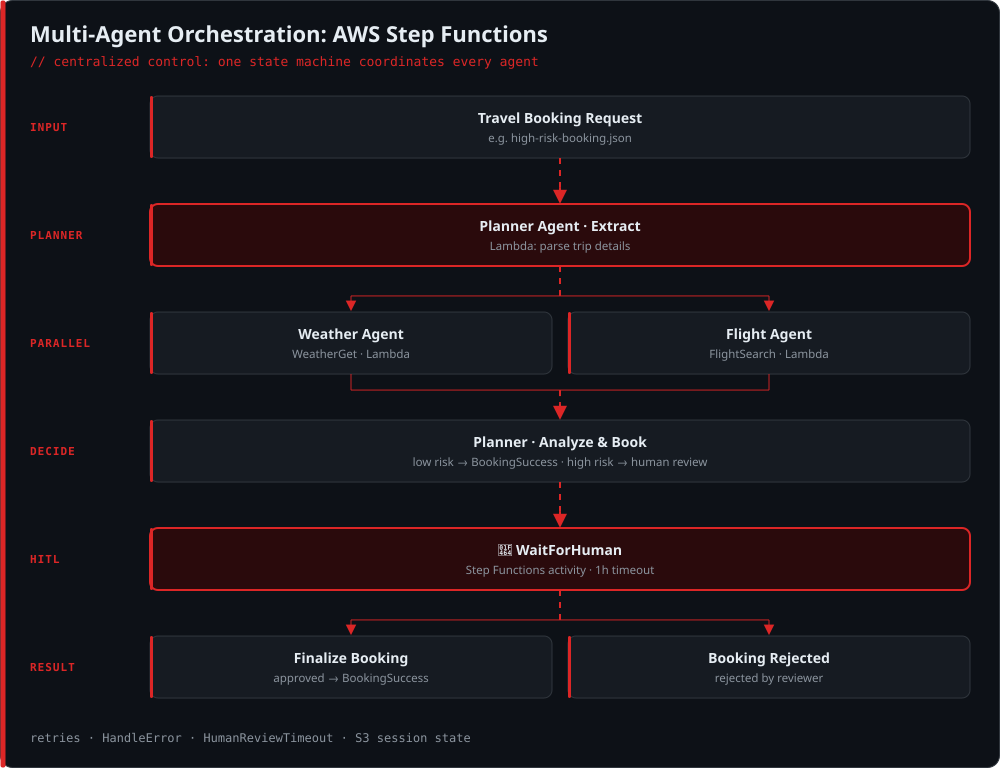

# AWS Multi-Agent Orchestration Pattern

An enterprise-grade multi-agent travel booking workflow implemented using **AWS Step Functions** and **Serverless Architecture**. This project demonstrates centralized orchestration control for coordinating distributed agent behaviors.

## Architecture Overview
- **Orchestration Layer**: AWS Step Functions (`travel-booking-orchestration`) managing state-driven workflow transitions.
- **Compute**: AWS Lambda serverless functions executing core business logic.
- **State Management**: Amazon S3 session management for context-sharing across multi-agent turns.

## Features
- Step-by-step state machine workflow coordination.
- Automated error handling, retries, and human-in-the-loop review routing.
- Scalable event-driven execution logging and observability.

## Repository Structure
- `travel-booking-orchestration.json`: Core Step Functions state machine definition.
- `high-risk-booking.json`: Test payload for high-value/high-risk routing flows.
- `events-human-review-approved.json`: Admin approval event payload.
